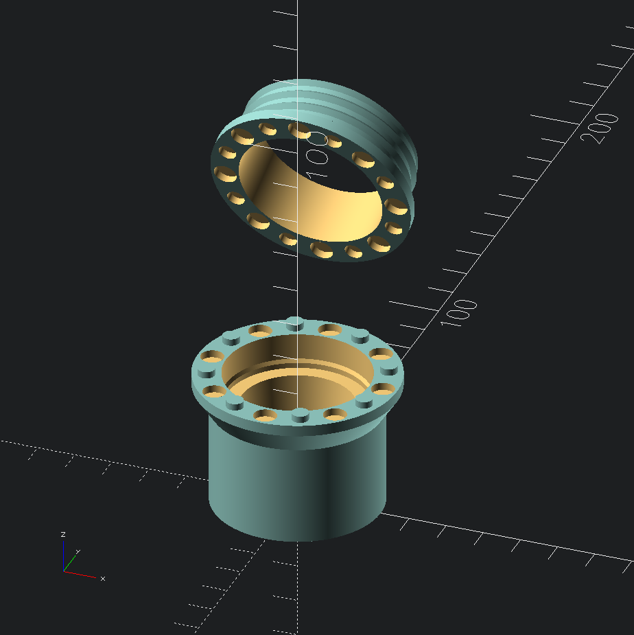
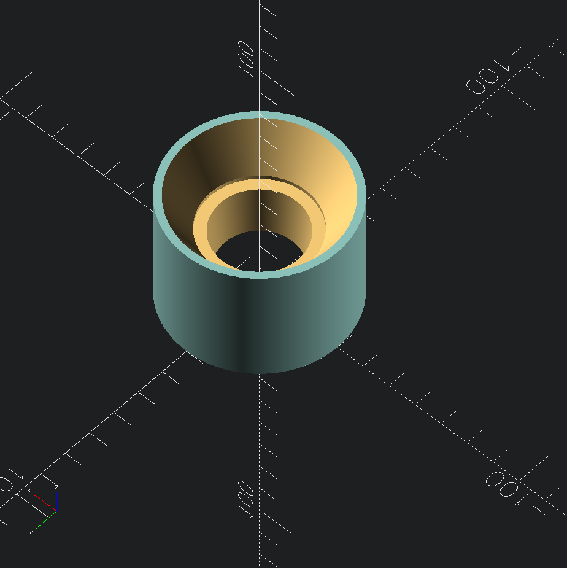
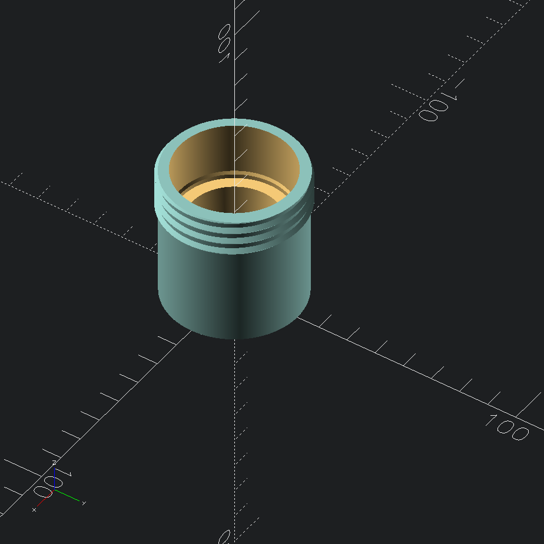

# Coffee Pod Funnel

This is a simple coffee pod funnel that enables you to refill your refillable coffee pods.
In it's default configuration it works for all-metal refillable nespresso style coffee pods.

Every parameter is customizable:

- Pod size (width on top and bottom, height)
- Funnel diameter and height
- Optional threaded top part in order to attach the funnel directly to a grinder
- Optional split-style design with a grinder attachment that couples magnetically with the funnel for fast and easy installation/removal

## Configuration examples

### Threaded insert for grinder + funnel with magnetic attachment and pins

### Funnel only

### Funnel with threads for grinder

